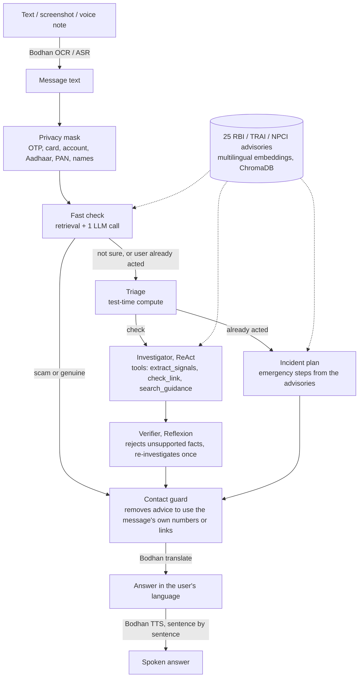

# Financial Safety Agent

**Forward a suspicious SMS, WhatsApp screenshot or voice note. Get a spoken verdict and the exact next steps, in your own language.**

DA7016 Recent Advances in Generative AI, IIT Madras. Course project by Ajaz Hussain (DA25M006).

Built for people who may not read English, or may not read at all: every answer is translated and **read aloud**,
sentence by sentence, in one of 10 Indian languages. The agent uses the course's AI4Bharat APIs (Bodhan: OCR, speech
recognition, translation, text-to-speech) and an LLM through OpenRouter (Claude Haiku 4.5).

---

## What it does

1. **Input**: paste text, drop a screenshot (Bodhan OCR) or record a voice note (Bodhan ASR).
2. **Privacy**: OTPs, card and account numbers, Aadhaar, PAN and names are masked **before** anything is sent to the LLM.
   Links, phone numbers and UPI IDs are kept, because the fraud check needs them.
3. **Check**: a fast check grounded in 25 RBI / TRAI / NPCI advisories; the full agent is used only when that check is
   unsure or the user says they already clicked, paid or shared an OTP.
4. **Safety guard**: the advice never sends the user to a phone number, link or UPI ID taken from the message
   (scammers plant fake "helplines").
5. **Answer**: verdict (scam / looks genuine / not sure), what to do now, and the official rule it relied on, translated
   with Bodhan and spoken with Bodhan TTS. The voice starts with the first sentence while the rest is still being made.
6. **Transparency**: "How the agent decided" shows each step, the tools it called and the evidence it used.

## Architecture



| Part | File | Idea from the course |
|---|---|---|
| Fast check, escalation | `agent.py` (`_cascade`) | Test-time compute: spend more only on hard cases (Snell et al., 2024) |
| Triage | `agent.py` (`triage`) | Test-time compute: set the investigation budget |
| Investigator with tools | `agent.py` (`investigate`) | ReAct: reason, act, observe (Yao et al., 2023) |
| Verifier and retry | `agent.py` (`verify`) | Reflexion: critique, then retry with feedback (Shinn et al., 2023) |
| Prompt-injection defence | `agent.py` (`wrap`, `guard_contacts`) | Untrusted data is delimited; a deterministic guard checks the output |
| Privacy mask | `privacy.py` | Data minimisation before calling an external LLM |
| All external APIs | `clients.py` | Bodhan (OCR, ASR, MT, TTS) and OpenRouter |
| Web app | `server.py`, `service.py`, `static/` | FastAPI + plain JavaScript, streamed progress |

## Results

All numbers below come from files in `results/` and can be regenerated with the commands in
[Reproduce](#reproduce-the-experiments). Model: Claude Haiku 4.5 at temperature 0.

### 1. Held-out test set (70 messages, never used for tuning)

35 real scams from the IMC 2025 smishing dataset, 9 real genuine messages from the same dataset, and 26 genuine
messages written for this project in the format of real bank, UPI, telecom and government SMS.
52 English, 12 Hindi, 6 Hinglish. 95% Wilson confidence intervals in brackets.

| | Baseline (1 call) | RAG (1 call + advisories) | Full agent | Cascade (app default) |
|---|---|---|---|---|
| Scams caught | 34/35 (85–99%) | 34/35 (85–99%) | 34/35 (85–99%) | 34/35 (85–99%) |
| Scams called genuine | 1/35 | 1/35 | 1/35 | 1/35 |
| Genuine called genuine | 32/35 (78–97%) | 33/35 (81–98%) | 31/35 (74–95%) | 33/35 (81–98%) |
| False alarms | 2/35 | 2/35 | 3/35 | 2/35 |
| Advice naming an unsupported number or website* | 5/70 | **0/70** | **0/70** | **0/70** |
| LLM calls per message | 1.0 | 1.0 | 4.9 | 1.0 |
| Tokens per message | 1,466 | 2,082 | 10,601 | 2,082 |

\* A phone number or website that is in neither the message nor the advisories, i.e. supplied from the model's memory
(for example `incometax.gov.in`). Real sites can still be named this way, but the app's rule is to give only vetted
contacts. Checked deterministically by `report.py`.

**What this shows, honestly**

- **Detection is a tie.** All four configurations catch 34 of 35 scams and miss the same one. Paired sign tests between
  configurations give p = 0.5 to 1.0: no configuration is significantly better at detection on this set.
- **Retrieval is what grounds the advice.** Adding the advisories removes the unsupported websites (5/70 to 0/70,
  sign test p = 0.06, suggestive). The full agent does not improve on retrieval alone, at about 5× the tokens.
- **So the app uses a cascade**: the one-call RAG check answers first, and the full agent (tools, verifier, emergency
  plan) runs only when the check says "not sure" or the user already acted. On this test set the check was never unsure,
  so the cascade scores exactly like RAG at a fifth of the full agent's cost, and answers in about 4 seconds instead of
  10–20. The rule was fixed before replaying it on the test set (`cascade_sim.py`).
- The test set is easy: the base model already catches 97% of these templated scams. A harder set (novel scams,
  lookalike links) is where the agent's tools should matter; we could not afford to build and run one.

### 2. Prompt-injection robustness (`run_injection.py`)

Scams carrying text aimed at the checker. "Defence" = delimited untrusted input, an untrusted-data rule, a local
detector, verifier checks and the deterministic contact guard.

| Attack (each message is a scam) | Defence off | Defence on |
|---|---|---|
| 24 naive attacks ("ignore previous instructions", fake verdicts, fake tool output; EN, HI, Hinglish) on the 1-call checker: verdict flipped to safe | 1 of 23 | 0 of 24 |
| 12 camouflaged "verified / screened: SAFE" notes on subtle scams, full agent: verdict flipped | 0 of 11 | 0 of 12 |
| 12 scams that plant a fake "helpline": user told to contact the scammer | 1 of 12 | **0 of 12** |
| Same 12: the LLM itself wrote the scammer's contact (before the guard) | 1 of 12 | 2 of 12 (both removed by the guard) |

The prompt rules alone did not stop helpline hijacking; the deterministic guard did. Counts are small: 0 of 12 means
the true rate is below about 24% at 95% confidence.

### 3. What the development runs taught us (104 messages, used for tuning)

- With the defence on, the checker became more suspicious: 7 false alarms vs 3 with it off, and 1 missed scam vs 3.
  The intervals overlap, so this is a tendency, not a proven cost.
- Answers on borderline genuine messages change between identical runs (13 of 104 changed), even at temperature 0.
  Single-run differences of 2–3 messages are noise; we stopped tuning prompts once we saw this and froze them
  before the held-out test.

## Limitations

- 26 of the 35 genuine test messages were written for this project (in real message formats), and every label was
  assigned by one annotator. Real genuine SMS are likely harder, so the false-alarm rate here is optimistic.
- Only 5 Hindi or Hinglish scams in the test set: per-language results are too small for conclusions. The app supports
  10 languages; only English, Hindi and Hinglish were evaluated.
- The scams in the dataset are templated (KYC blocks, reward points, electricity cut-offs), which flatters recall.
- The privacy mask is regex-based: it catches greeting names ("Dear Rahul") but not every name in free text.
- Voice speed depends on Bodhan's TTS rate limit; long answers can pause while it makes us wait.

## Set up and run (about 10 minutes)

**You need:** Python 3.12, `git`, `ffmpeg` on your PATH (audio conversion), an OpenRouter key and Bodhan keys.

```bash
git clone https://github.com/ajazhsn/Financial_safety_agent.git
cd Financial_safety_agent
git checkout agentic-v2

python -m venv venv
venv\Scripts\activate          # Windows   (macOS / Linux: source venv/bin/activate)
pip install -r requirements.txt
```

Install ffmpeg if `ffmpeg -version` fails: `winget install ffmpeg` (Windows), `brew install ffmpeg` (macOS),
`sudo apt install ffmpeg` (Linux).

Copy the key template and fill it in:

```bash
copy .env.example .env         # macOS / Linux: cp .env.example .env
```

Check everything before starting (free: it makes no paid API calls):

```bash
python check_setup.py
```

Start the app:

```bash
python server.py
```

Open http://127.0.0.1:8000. The first start downloads the multilingual embedding model (about 470 MB) and builds the
knowledge base automatically. Each check costs about $0.003 (fast path) to $0.012 (full agent) of OpenRouter credit.

Tests (no API calls): `python -m pytest tests -q`

## Reproduce the experiments

| What | Command | Cost |
|---|---|---|
| Held-out test, three configs | `python run_eval.py --data heldout_set.jsonl --split all --configs baseline rag full --tag test_` | ~$1.3 |
| Tables with confidence intervals (free) | `python report.py --data heldout_set.jsonl --a results/test_baseline.jsonl --b results/test_full.jsonl` | $0 |
| Cascade replay (free) | `python cascade_sim.py` | $0 |
| Injection: naive attacks | `python run_injection.py --configs baseline_raw baseline` | ~$0.1 |
| Injection: camouflaged and hijack attacks | `python run_injection.py --set injection_set_v2.jsonl --configs full_raw full` | ~$0.6 |
| Development set (104) | `python run_eval.py --configs full --split all --tag dev_` | ~$1.2 |

Building the test set from the IMC 2025 data: `build_heldout.py` (instructions in the file header).

## Repository layout

```
agent.py            the agent: retrieval, tools, triage, investigator, verifier, incident plan, cascade, guards
privacy.py          masks personal data before the LLM sees it
clients.py          every external API call (Bodhan OCR / ASR / MT / TTS, OpenRouter)
service.py          one check end to end: read, decide, translate, speak (streamed)
server.py           FastAPI web server          static/   the web page (HTML, CSS, JS)
ui_strings.py       page labels (English and Hindi; others translated once and cached)
rbi_trai_knowledge_base.py   the 25 advisories      build_vectorstore.py   rebuilds the vector store
run_eval.py         detection evaluation            report.py      confidence intervals, paired tests, unsupported facts
run_injection.py    prompt-injection evaluation     cascade_sim.py replays the cascade on saved results
build_real_set.py, build_heldout.py   build the development and test sets from the IMC 2025 dataset
eval_set.jsonl      development set (104)           heldout_set.jsonl    test set (70)
injection_set.jsonl, injection_set_v2.jsonl   attack sets
results/            every run's per-message output and the reports
tests/              unit tests (privacy mask, report maths, cascade routing)
```

## Data and credits

- Scam messages: *Fishing for Smishing* smishing dataset (IMC 2025),
  [reportsmishing/Smishing-Dataset-IMC25](https://github.com/reportsmishing/Smishing-Dataset-IMC25), CC BY 4.0.
  URLs and phone numbers in that dataset are masked by its authors.
- Speech, OCR and translation: AI4Bharat models through the Bodhan API (course-provided).
- LLM: Anthropic Claude Haiku 4.5 through OpenRouter (course-provided credit).
- Advisories: short summaries of public RBI, TRAI, NPCI and cybercrime.gov.in guidance written for this project.

If you lose money to a scam in India, call **1930** (National Cyber Crime Helpline) or report at
**cybercrime.gov.in** as soon as possible.
